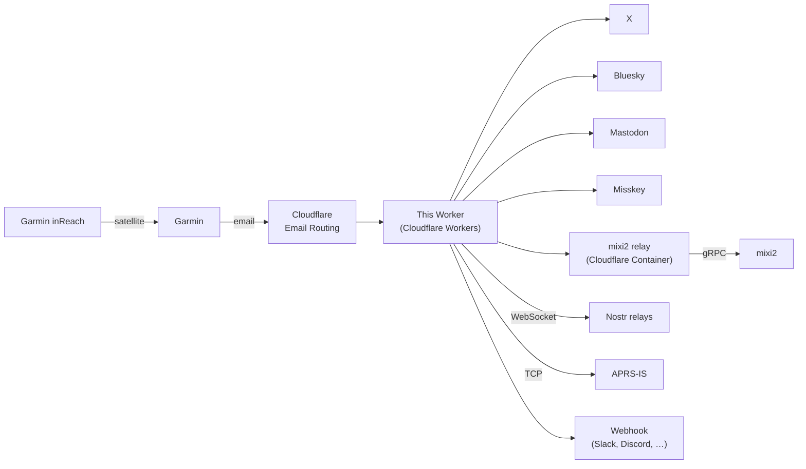
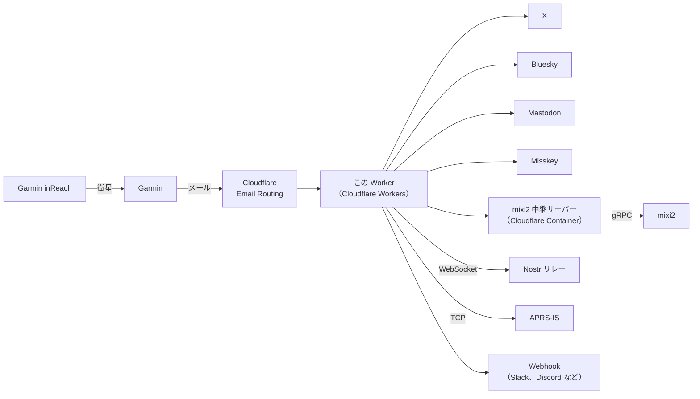

# Post to Social Media from inReach

> This is a Cloudflare Worker that receives Garmin inReach messages by email and cross-posts them, with geohash, grid locator and a map link, to X, Bluesky, Mastodon, Misskey, mixi2, Nostr, APRS-IS and webhooks — no cellphone signal required.
>
> Garmin inReach からメールで届いたメッセージを、ジオハッシュ・グリッドロケーター・地図リンク付きで X、Bluesky、Mastodon、Misskey、mixi2、Nostr、APRS-IS、Webhook へ同時投稿する Cloudflare Worker です。携帯電話の電波が届かない場所から投稿できます。

[](https://deploy.workers.cloudflare.com/?url=https://github.com/halka/inReach2socialmedia)

[English](#english) | [日本語](#日本語)

## English

Post messages sent from a Garmin inReach satellite communicator to social media and other services, together with the location they were sent from.



Use any combination of destinations: a destination is used when its settings are present, and the others are skipped. Each message is sent to all of them at once, and one failing does not stop the rest.

### What gets posted

```
MAKE VTEC, GREAT AGAIN
Geohash: xn77h0j9r
Grid: PM95vq
https://maps.google.com/?q=35.683851,139.753973
```

- the message you typed on the inReach
- the [geohash](https://en.wikipedia.org/wiki/Geohash) of the location
- the [Grid Locator / Maidenhead Locator](https://en.wikipedia.org/wiki/Maidenhead_Locator_System) of the location
- a Google Maps link to the location

The same text goes to every destination, so it is fitted to the strictest limits: X's 280, counted the way X counts it with [twitter-text](https://github.com/twitter/twitter-text) (Japanese and emoji count as 2, every URL or bare domain counts as 23), and Bluesky's 300 characters. If it is too long, the message is shortened and ends in "…". The location lines are kept.

When a message has no GPS fix (Garmin sends `Lat 0 Lon 0`), the Imperial Palace in Tokyo is used as the location. Emails that are not inReach notifications are posted as their first non-empty line.

### Quick start

You need a Cloudflare account with a domain that has Email Routing enabled, a GitHub account, and an account on at least one [destination](#destinations). The Worker runs on Cloudflare Workers, so nothing needs to be installed on your computer.

**1. Deploy.** Click this button:

[](https://deploy.workers.cloudflare.com/?url=https://github.com/halka/inReach2socialmedia)

Cloudflare copies this repository to your GitHub account, then builds and deploys the Worker `inreach2socialmedia`. Each push to your copy deploys it again. All settings are made in the Cloudflare dashboard, so you do not need to edit any file.

**2. Add the settings in the Cloudflare dashboard.** Go to **Workers & Pages → inreach2socialmedia → Settings → Variables and Secrets**, and click **Add** for each setting. Choose the type **Text** for ordinary values, **JSON** for lists, and **Secret** for passwords, tokens and keys. Click **Deploy** (or **Save**) to apply them.

- `permittedAddresses` (JSON) is required: the sender addresses that may post, such as `["sender@example.com"]`.
- If Garmin's notification emails do not arrive in Japanese, also set `INREACH_SUBJECT_TRIGGER`. See [Settings](#settings).
- Then add the settings of each destination you want. See [Destinations](#destinations).

**3. Route an email address to the Worker.** In the Cloudflare dashboard, open your domain, go to **Email → Email Routing → Routing rules**, and create a custom address (for example `inreach-xxxx@example.com`) with the action **Send to a Worker** → `inreach2socialmedia`. Choose an address that is hard to guess.

**4. Send a message.** On the inReach (or in the Garmin Explore app), add that address as a contact and send it a message. It is posted within a minute or so.

If nothing is posted, open the Worker's **Logs** tab in the dashboard (**Workers & Pages → inreach2socialmedia → Logs**), start the live log, and send another message. It shows each destination's result.

<details>
<summary>Deploying from your computer instead</summary>

With Node.js installed, you can deploy with Wrangler instead of the button:

```sh
git clone https://github.com/halka/inReach2socialmedia.git
cd inReach2socialmedia
npm install
npx wrangler login
npx wrangler deploy
```

Then continue from step 2. `npx wrangler tail` shows the live log.

</details>

### Settings

Add these under **Settings → Variables and Secrets** of the Worker, like the destination settings.

| Variable | Type | Default | Description |
|---|---|---|---|
| `permittedAddresses` | JSON | (required) | The sender addresses that may post, as a JSON array, e.g. `["sender@example.com"]`. Use the address your inReach messages come from: send one message from the inReach to your own email address and look at its `From:`. Compared case-insensitively. Mail from any other sender is rejected. |
| `INREACH_SUBJECT_TRIGGER` | Text | `さんからのinReachメッセージ` | Text in the subject that marks an inReach notification. The sender's name is the part of the subject before it. The default matches Garmin's Japanese notification. **If your notifications arrive in another language, set this** to the matching part of their subject, or only the first line of each email is posted, without the location. |
| `GEOHASH_PRECISION` | Text | `9` (about 5 m) | Geohash length, 1–12. |
| `MAIDENHEAD_PRECISION` | Text | `6` (5 × 2.5 arc minutes, about 7 × 5 km in Japan) | Maidenhead locator length: 2, 4, 6, 8 or 10. |

> [!WARNING]
> The sender check uses the email's `From:` header, which a sender can forge. Keep the receiving address private.

- An invalid precision is logged and replaced by the default.
- List settings (`permittedAddresses`, `NOSTR_RELAYS`, `WEBHOOK_URL`) take a JSON array with the type **JSON**. They also accept the same array as Text, or the items separated by commas or spaces. `permittedAddresses` also accepts `{"address": [...]}`.

### Destinations

Add each setting under **Settings → Variables and Secrets** of the Worker, with the type shown. Settings marked optional can be left out. Click a destination to open its steps.

<details>
<summary><strong>X (Twitter)</strong></summary>

Create an app in the [X developer portal](https://developer.x.com/) with **Read and write** permission, and generate its access token and secret.

| Variable | Type | Value |
|---|---|---|
| `X_API_KEY` | Secret | API key |
| `X_API_SECRET` | Secret | API key secret |
| `X_API_ACCESS_TOKEN` | Secret | Access token |
| `X_API_ACCESS_TOKEN_SECRET` | Secret | Access token secret |

</details>

<details>
<summary><strong>Bluesky</strong></summary>

Create an app password in Bluesky under **Settings → Privacy and security → App passwords**. Do not use your main password.

| Variable | Type | Value |
|---|---|---|
| `BLUESKY_IDENTIFIER` | Text | Your handle, e.g. `you.bsky.social` |
| `BLUESKY_APP_PASSWORD` | Secret | The app password |
| `BLUESKY_SERVICE` | Text | Optional. Your PDS, e.g. `https://your-pds.example`, if your account is not on bsky.social |

</details>

<details>
<summary><strong>Mastodon</strong></summary>

On your server, go to **Preferences → Development → New application**, give it the `write:statuses` scope, and copy **Your access token**.

| Variable | Type | Value |
|---|---|---|
| `MASTODON_URL` | Text | Your server, e.g. `https://mastodon.social` |
| `MASTODON_ACCESS_TOKEN` | Secret | The access token |

</details>

<details>
<summary><strong>Misskey</strong></summary>

On your server, go to **Settings → API → Generate access token** and allow **Compose or delete notes**.

| Variable | Type | Value |
|---|---|---|
| `MISSKEY_URL` | Text | Your server, e.g. `https://misskey.io` |
| `MISSKEY_ACCESS_TOKEN` | Secret | The access token |

</details>

<details>
<summary><strong>Nostr</strong></summary>

Use your private key. Consider a key just for this rather than your main one.

| Variable | Type | Value |
|---|---|---|
| `NOSTR_PRIVATE_KEY` | Secret | `nsec1…` or 64 hex characters |
| `NOSTR_RELAYS` | JSON | Optional. Relays as a JSON array, e.g. `["wss://relay.damus.io", "wss://your.relay.example"]`. Default: `wss://relay.damus.io`, `wss://nos.lol` and `wss://yabu.me` |

It counts as posted when at least one relay accepts it.

</details>

<details>
<summary><strong>APRS</strong></summary>
> [!CAUTION]
> 
> **You need a valid amateur radio license.**
> 
> Follow the radio regulations of your country. In Japan, for example, an operator must carry their radio operator license while operating (Radio Act Enforcement Regulations, Article 38, Paragraph 11).

Your position appears on APRS maps such as [aprs.fi](https://aprs.fi/), with the message as the comment. This needs an amateur radio callsign and its APRS-IS passcode.

| Variable | Type | Value |
|---|---|---|
| `APRS_CALLSIGN` | Text | Your callsign with an SSID if you like, e.g. `JA1ABC-7` |
| `APRS_PASSCODE` | Secret | The APRS-IS passcode for the callsign |
| `APRS_SERVER` | Text | Optional. One of the servers below. Default: `rotate.aprs2.net:14580` |
| `APRS_SYMBOL` | Text | Optional. One of the map symbols below, e.g. `H[`. Default: `/[` |
| `APRS_APP_NAME` | Text | Optional. The software name sent when logging in to APRS-IS, shown on the server's status page. Spaces become `-`. Default: `inReach2socialmedia` |

- The report carries the position, so the comment is only the message: no geohash, grid or map link. It is ASCII only: full-width letters and digits become half-width, and Japanese and other non-ASCII characters are removed. It is put on one line and cut to 43 characters (the APRS limit). A message written only in Japanese is sent as the position with no comment.
- Messages without a GPS fix are not sent to APRS, so the fallback location is never reported as your position.

**Servers.** The report is sent to APRS-IS over the internet. These are the [APRS-IS tier 2](https://www.aprs2.net/) servers:

| Server | Region |
|---|---|
| `rotate.aprs2.net:14580` | Any server worldwide (default) |
| `asia.aprs2.net:14580` | Asia |
| `noam.aprs2.net:14580` | North America |
| `euro.aprs2.net:14580` | Europe |
| `aunz.aprs2.net:14580` | Australia and New Zealand |
| `soam.aprs2.net:14580` | South America |

**Map symbols.** Enter the two characters as they are. The list follows the current APRS 1.2 symbol set ([symbolsX.txt](https://www.aprs.org/symbols/symbolsX.txt) and its overlay extension [symbols-new.txt](https://www.aprs.org/symbols/symbols-new.txt), revised 17 Mar 2021):

| Group | Symbol | Emoji | Meaning |
|---|---|---|---|
| People | `/[` | 🧍 | Person (default) |
|  | `H[` | 🥾 | Hiker |
|  | `R[` | 🏃 | Runner |
|  | `S[` | ⛷️ | Skier |
|  | `B[` | 👶 | Baby stroller |
| On land | `/b` | 🚲 | Bicycle |
|  | `/<` | 🏍️ | Motorcycle |
|  | `/e` | 🐎 | Horse |
|  | `/>` | 🚗 | Car |
|  | `/j` | 🚙 | Jeep |
|  | `\k` | 🚙 | SUV |
|  | `4k` | 🛻 | 4x4 |
|  | `Ak` | 🛞 | ATV |
|  | `/R` | 🚐 | Recreational vehicle |
|  | `/k` | 🚚 | Truck |
|  | `/U` | 🚌 | Bus |
|  | `/*` | 🛷 | Snowmobile |
| Rail | `/=` | 🚂 | Train (generic) |
|  | `B=` | 🚋 | Tram, streetcar, trolley |
|  | `C=` | 🚆 | Commuter train |
|  | `D=` | 🚆 | Diesel train |
|  | `E=` | 🚃 | Electric train |
|  | `F=` | 🚃 | Freight train |
|  | `G=` | 🚡 | Gondola, ropeway |
|  | `H=` | 🚄 | High-speed rail |
|  | `I=` | 🚞 | Inclined rail (funicular) |
|  | `L=` | 🚈 | Elevated railway |
|  | `M=` | 🚝 | Monorail |
|  | `P=` | 🚆 | Passenger train |
|  | `S=` | 🚂 | Steam locomotive |
|  | `T=` | 🚉 | Station |
|  | `U=` | 🚇 | Subway |
|  | `X=` | 🚞 | Excursion train |
| On water | `/C` | 🛶 | Canoe |
|  | `/Y` | ⛵ | Sailboat (yacht) |
|  | `/s` | 🚤 | Power boat |
|  | `Bs` | 🛥️ | Pleasure boat |
|  | `Js` | 🌊 | Jet ski |
|  | `Ds` | 🤿 | Diving |
|  | `Fs` | 🎣 | Fishing |
| In the air | `/'` | 🛩️ | Small aircraft |
|  | `/^` | ✈️ | Large aircraft |
|  | `/X` | 🚁 | Helicopter |
|  | `/g` | 🛩️ | Glider |
|  | `/O` | 🎈 | Balloon |
|  | `D^` | 🛸 | Drone |
| Places | `/;` | ⛺ | Portable operation (tent) |
|  | `S;` | ⛰️ | Summits on the Air (SOTA) |
|  | `I;` | 🏝️ | Islands on the Air (IOTA) |
|  | `\;` | 🏞️ | Park, picnic |
|  | `/-` | 🏠 | House |

A symbol starting with a letter or digit, such as `H[`, is an overlay from the APRS 1.2 extension. Some apps draw it as the base symbol with the letter on top. The emoji are only a guide: maps show the APRS icon.

</details>

<details>
<summary><strong>Webhook</strong></summary>

| Variable | Type | Value |
|---|---|---|
| `WEBHOOK_URL` | Secret | The webhook URL. For several, a JSON array such as `["https://…", "https://…"]`, or URLs separated by spaces or commas |

Each message is sent as a JSON POST:

```json
{
  "text": "…", "content": "…",
  "message": "…", "latitude": 35.683851, "longitude": 139.753973,
  "geohash": "xn77h0j9r", "maidenhead": "PM95vq", "mapUrl": "https://maps.google.com/?q=35.683851,139.753973",
  "isFallbackLocation": false
}
```

`text` and `content` are both the finished post text. Slack incoming webhooks read `text` and Discord webhooks read `content`, so their URLs work as they are. The other fields are its parts, for services that build their own post (n8n, Zapier, your own server). They are `null` when the email was not an inReach notification. `isFallbackLocation` is `true` when the message had no GPS fix and the location is the Imperial Palace. `message` is never shortened.

</details>

<details>
<summary><strong>mixi2</strong></summary>

Posts go to mixi2 with [mixi2-js](https://mixi2.js.org/). mixi2-js needs Node.js and cannot run in the Worker itself: the mixi2 API accepts only gRPC, which Workers cannot send, and its protobuf library generates code at runtime, which Workers forbid. So it runs in a [Cloudflare Container](https://developers.cloudflare.com/containers/) next to the Worker: [`relay/mixi2/`](relay/mixi2/), started by the Worker when a message arrives and asleep otherwise. Only the Worker can reach it. mixi2 posts are limited to 149 characters, so the relay rebuilds the post: it keeps the location lines and shortens the message.

This needs the **Workers Paid** plan (Containers are not on the free plan). Cloudflare builds the container image when it deploys. (If you deploy from your computer instead, [Docker](https://docs.docker.com/get-started/get-docker/) must be running there.)

1. On the [mixi2 Developer Platform](https://developer.mixi.social/), apply for access, create an application and note its **client ID** and **client secret**.
2. In your copy of the repository on GitHub, add this to the end of `wrangler.toml` and commit. Cloudflare deploys it with the container:

   ```toml
   # mixi2: runs relay/mixi2 in a Cloudflare Container
   [[containers]]
   class_name = "Mixi2Relay"
   scheduling_policy = "durable_object"
   
   [containers.images.base]
   dockerfile = "./relay/mixi2/Dockerfile"
   
   [[durable_objects.bindings]]
   name = "MIXI2_RELAY"
   class_name = "Mixi2Relay"
   
   [exports.Mixi2Relay]
   type = "durable-object"
   storage = "sqlite"
   ```

3. Add the settings to the Worker:

   | Variable | Type | Value |
   |---|---|---|
   | `MIXI2_CLIENT_ID` | Text | Client ID |
   | `MIXI2_CLIENT_SECRET` | Secret | Client secret |

   After changing them, the container picks them up the next time it starts. It stops 2 minutes after the last message.

**Without the paid plan:** run `relay/mixi2/` on any other host that runs Node.js 20.19 or later or a Docker image (Cloud Run, Fly.io, Render, your own server) over HTTPS, and connect it as a webhook instead of steps 2 and 3:

1. Make a long random token, for example with `node -e "console.log(crypto.randomUUID())"`.
2. Deploy `relay/mixi2/` with the environment variables `MIXI2_CLIENT_ID`, `MIXI2_CLIENT_SECRET` and `RELAY_TOKEN` (the token). On Google Cloud Run, for example:

   ```sh
   gcloud run deploy inreach-mixi2 --source relay/mixi2 --allow-unauthenticated \
     --set-env-vars MIXI2_CLIENT_ID=…,MIXI2_CLIENT_SECRET=…,RELAY_TOKEN=…
   ```

   On your own server, run `npm install` and then `npm start` in `relay/mixi2/` (it listens on `PORT`, 8080 by default).
3. Add `https://<your relay>/?token=<RELAY_TOKEN>` to the Worker's `WEBHOOK_URL` (Secret). If you already have other webhooks, put them all in `WEBHOOK_URL`, separated by spaces.

</details>

### Adding a destination

Each destination is a file in `worker/destinations/` that says which settings it needs and how to post the text. Copy one, such as `mastodon.ts`, change it for your service, and add it to the list in `worker/destinations/index.ts`.

---

## 日本語

Garmin inReach（衛星通信機）から送ったメッセージを、送信した場所の情報と一緒に SNS などのサービスへ投稿します。



投稿先は自由に組み合わせられます。設定のある投稿先にだけ投稿し、設定のないものは飛ばします。すべての投稿先に同時に送り、どれかが失敗してもほかの投稿先には投稿されます。

### 投稿の内容

```
御所
ｳﾞｫｰｰｰｰｰｰｰｰｰｰｰｰｰｰｰｰｰｰｰｰｰｰｰﾝ
Geohash: xn77h0j9r
Grid: PM95vq
https://maps.google.com/?q=35.683851,139.753973
```

- inReach で入力したメッセージ
- その場所の [geohash](https://ja.wikipedia.org/wiki/ジオハッシュ)
- その場所の [グリッドロケーター](https://en.wikipedia.org/wiki/Maidenhead_Locator_System)（グリッドロケーター）
- その場所の Google マップのリンク

すべての投稿先に同じ文を送るため、最も厳しい制限に収まるように調整します。X の 280 字（[twitter-text](https://github.com/twitter/twitter-text) を使って X と同じ方法で数えます。日本語と絵文字は 2、URL やドメイン名は長さに関係なく 23）と、Bluesky の 300 字です。長すぎる場合はメッセージを短くして末尾を「…」にします。位置情報の行は残します。

GPS の位置が取れなかったメッセージ（Garmin が `Lat 0 Lon 0` を送ってきた場合）は、皇居の座標を使います。inReach の通知ではないメールは、本文の最初の空でない行を投稿します。

### クイックスタート

必要なもの：Email Routing を有効にした独自ドメインのある Cloudflare アカウント、GitHub アカウント、[投稿先](#投稿先)のいずれか 1 つ以上のアカウント。Cloudflare Workers で動くので、パソコンに何かをインストールする必要はありません。

**1. デプロイする。** 次のボタンをクリックします。

[](https://deploy.workers.cloudflare.com/?url=https://github.com/halka/inReach2socialmedia)

Cloudflare がこのリポジトリを自分の GitHub アカウントにコピーし、Worker `inreach2socialmedia` をビルドしてデプロイします。コピーしたリポジトリに push するたびに、もう一度デプロイされます。設定はすべて Cloudflare のダッシュボードで行うので、ファイルを編集する必要はありません。

**2. Cloudflare のダッシュボードで設定を追加する。** **Workers & Pages → inreach2socialmedia → 設定（Settings）→ 変数とシークレット（Variables and Secrets）** を開き、設定ごとに **追加（Add）** します。通常の値は種類を **テキスト（Text）**、一覧は **JSON**、パスワード・トークン・鍵は **シークレット（Secret）** にします。最後に **デプロイ（Deploy）**（または **保存**）で反映します。

- `permittedAddresses`（JSON）は必須です。投稿を許可する送信元アドレスを `["sender@example.com"]` のように書きます。
- Garmin の通知メールが日本語以外で届く場合は、`INREACH_SUBJECT_TRIGGER` も設定します。[基本設定](#基本設定)を参照してください。
- 続けて、使う投稿先の設定を追加します。[投稿先](#投稿先)を参照してください。

**3. メールアドレスを Worker に振り分ける。** Cloudflare のダッシュボードでドメインを開き、**Email → Email Routing → Routing rules** でカスタムアドレス（例：`inreach-xxxx@example.com`）を作り、アクションを **Send to a Worker** → `inreach2socialmedia` にします。推測されにくいアドレスにしてください。

**4. メッセージを送る。** inReach（または Garmin Explore アプリ）でそのアドレスを連絡先に追加し、メッセージを送ります。1 分ほどで投稿されます。

投稿されない場合は、ダッシュボードで Worker の **ログ（Logs）** タブ（**Workers & Pages → inreach2socialmedia → Logs**）を開いてライブログを開始し、もう一度メッセージを送ってください。投稿先ごとの結果が表示されます。

<details>
<summary>パソコンからデプロイする場合</summary>

Node.js があれば、ボタンの代わりに Wrangler でデプロイできます。

```sh
git clone https://github.com/halka/inReach2socialmedia.git
cd inReach2socialmedia
npm install
npx wrangler login
npx wrangler deploy
```

そのあと手順 2 から進めます。`npx wrangler tail` でライブログを見られます。

</details>

### 基本設定

投稿先の設定と同じく、Worker の **設定 → 変数とシークレット** に追加します。

| 変数 | 種類 | 初期値 | 説明 |
|---|---|---|---|
| `permittedAddresses` | JSON | （必須） | 投稿を許可する送信元アドレスの JSON 配列（例：`["sender@example.com"]`）。inReach のメッセージの送信元アドレスを使います。送信元アドレスは、inReach から自分のメールアドレスにメッセージを 1 通送り、届いたメールの `From:` で確認できます。大文字・小文字は区別しません。これ以外の送信元からのメールは拒否します。 |
| `INREACH_SUBJECT_TRIGGER` | テキスト | `さんからのinReachメッセージ` | inReach の通知メールだと判定するための、件名に含まれる文字列。件名のこの文字列より前の部分を送信者名として使います。初期値は Garmin の日本語の通知メールに合わせてあります。**別の言語で届く場合は必ず設定してください。** 設定しないと、メールの最初の行だけが位置情報なしで投稿されます。 |
| `GEOHASH_PRECISION` | テキスト | `9`（約 5 m） | geohash の桁数。1〜12。 |
| `MAIDENHEAD_PRECISION` | テキスト | `6`（経度 5 分 × 緯度 2.5 分、日本で約 7 × 5 km） | Maidenhead ロケーターの文字数。2・4・6・8・10 のいずれか。 |

> [!WARNING]
> 送信元のチェックにはメールの `From:` ヘッダーを使っています。このヘッダーは送信者が偽装できるので、受信用アドレスは公開しないでください。

- 桁数の設定が不正な場合は、ログに警告を出して初期値を使います。
- 一覧の設定（`permittedAddresses`、`NOSTR_RELAYS`、`WEBHOOK_URL`）は、種類 **JSON** で JSON 配列を設定します。同じ配列をテキストで設定したり、カンマやスペースで区切って書いたりすることもできます。`permittedAddresses` は `{"address": [...]}` の形式も使えます。

### 投稿先

Worker の **設定 → 変数とシークレット** に、示した種類で追加します。「任意」の設定は省略できます。投稿先の名前をクリックすると手順が開きます。

<details>
<summary><strong>X（Twitter）</strong></summary>

[X の開発者ポータル](https://developer.x.com/)で **Read and write** 権限のアプリを作り、アクセストークンとシークレットを発行します。

| 変数 | 種類 | 値 |
|---|---|---|
| `X_API_KEY` | シークレット | API キー |
| `X_API_SECRET` | シークレット | API キーシークレット |
| `X_API_ACCESS_TOKEN` | シークレット | アクセストークン |
| `X_API_ACCESS_TOKEN_SECRET` | シークレット | アクセストークンシークレット |

</details>

<details>
<summary><strong>Bluesky</strong></summary>

Bluesky の **設定 → プライバシーとセキュリティ → アプリパスワード** でアプリパスワードを作ります。普段のパスワードは使わないでください。

| 変数 | 種類 | 値 |
|---|---|---|
| `BLUESKY_IDENTIFIER` | テキスト | ハンドル（例：`you.bsky.social`） |
| `BLUESKY_APP_PASSWORD` | シークレット | アプリパスワード |
| `BLUESKY_SERVICE` | テキスト | 任意。bsky.social 以外の PDS のアカウントの場合、その PDS（例：`https://your-pds.example`） |

</details>

<details>
<summary><strong>Mastodon</strong></summary>

自分のサーバーの **ユーザー設定 → 開発 → 新規アプリ** で `write:statuses` のスコープを付けてアプリを作り、**アクセストークン** をコピーします。

| 変数 | 種類 | 値 |
|---|---|---|
| `MASTODON_URL` | テキスト | 自分のサーバー（例：`https://mstdn.jp`） |
| `MASTODON_ACCESS_TOKEN` | シークレット | アクセストークン |

</details>

<details>
<summary><strong>Misskey</strong></summary>

自分のサーバーの **設定 → API → アクセストークンの発行** で **ノートを作成・削除する** を許可してトークンを発行します。

| 変数 | 種類 | 値 |
|---|---|---|
| `MISSKEY_URL` | テキスト | 自分のサーバー（例：`https://misskey.io`） |
| `MISSKEY_ACCESS_TOKEN` | シークレット | アクセストークン |

</details>

<details>
<summary><strong>Nostr</strong></summary>

秘密鍵を使います。普段使いの鍵ではなく、専用の鍵を作ることも検討してください。

| 変数 | 種類 | 値 |
|---|---|---|
| `NOSTR_PRIVATE_KEY` | シークレット | `nsec1…` または 16 進数 64 文字 |
| `NOSTR_RELAYS` | JSON | 任意。リレーの JSON 配列（例：`["wss://yabu.me", "wss://your.relay.example"]`）。初期値は `wss://relay.damus.io`、`wss://nos.lol`、`wss://yabu.me` |

1 つ以上のリレーが受け付ければ投稿成功とみなします。

</details>

<details>
<summary><strong>APRS</strong></summary>

> [!CAUTION]
> アマチュア無線技士の資格と有効なコールサインが必要です。
> 運用中は、無線従事者免許証を携帯してください。

> [!IMPORTANT]
> **電波法施行規則 第38条第11項**
> 無線従事者は、その業務に従事しているときは、無線従事者の免許証（法第39条又は法第50条の規定により船舶局無線従事者証明を要することとされた者については、無線従事者の免許証及び船舶局無線従事者証明書）を携帯していなければならない。
>
> **電波法 第4条**
> 無線局を開設しようとする者は、総務大臣の免許を受けなければならない。（ただし書略）
>
> **電波法 第79条**
> 総務大臣は、無線従事者が左の各号の一に該当するときは、その免許を取り消し、又は三箇月以内の期間を定めてその業務に従事することを停止することができる。（各号略）
>
> [電波法 | e-Gov 法令検索](https://laws.e-gov.go.jp/law/325AC0000000131)・[電波法施行規則 | e-Gov 法令検索](https://laws.e-gov.go.jp/law/325M50080000014)


[aprs.fi](https://aprs.fi/) などの APRS の地図に、メッセージをコメントにして現在地を表示します。アマチュア無線のコールサインと、その APRS-IS パスコードが必要です。

| 変数 | 種類 | 値 |
|---|---|---|
| `APRS_CALLSIGN` | テキスト | コールサイン。SSID を付けても構いません（例：`JA1ABC-7`） |
| `APRS_PASSCODE` | シークレット | コールサインの APRS-IS パスコード |
| `APRS_SERVER` | テキスト | 任意。下のサーバーのどれか。初期値は `rotate.aprs2.net:14580` |
| `APRS_SYMBOL` | テキスト | 任意。下の地図のシンボルのどれか（例：`H[`）。初期値は `/[` |
| `APRS_APP_NAME` | テキスト | 任意。APRS-IS にログインするときに送るアプリケーション名。サーバーの状態ページに表示されます。スペースは `-` に変わります。初期値は `inReach2socialmedia` |

- 位置はレポート自体に含まれるので、コメントはメッセージだけです（geohash、グリッドロケーター、地図のリンクは送りません）。コメントは英数字などの ASCII 文字だけにします。全角の英数字は半角に変え、日本語などの ASCII 以外の文字は取り除きます。1 行にまとめ、43 字（APRS の上限）で切ります。日本語だけのメッセージは、コメントなしで位置だけを送ります。
- GPS の位置が取れなかったメッセージは APRS に送りません。代わりの座標（皇居）を現在地として報告することはありません。

**サーバー。** 位置情報はインターネット経由で APRS-IS に送ります。[APRS-IS の Tier 2](https://www.aprs2.net/) のサーバーは次のとおりです。

| サーバー | 地域 |
|---|---|
| `rotate.aprs2.net:14580` | 世界中のサーバーのどれか（初期値） |
| `asia.aprs2.net:14580` | アジア |
| `noam.aprs2.net:14580` | 北米 |
| `euro.aprs2.net:14580` | ヨーロッパ |
| `aunz.aprs2.net:14580` | オーストラリア・ニュージーランド |
| `soam.aprs2.net:14580` | 南米 |

**地図のシンボル。** 2 文字をそのまま入力します。一覧は現行の APRS 1.2 のシンボル（[symbolsX.txt](https://www.aprs.org/symbols/symbolsX.txt) と、その拡張の [symbols-new.txt](https://www.aprs.org/symbols/symbols-new.txt)、2021 年 3 月 17 日改訂）に基づいています。

| 分類 | シンボル | 絵文字 | 意味 |
|---|---|---|---|
| 人 | `/[` | 🧍 | 人（初期値） |
|  | `H[` | 🥾 | ハイカー |
|  | `R[` | 🏃 | ランナー |
|  | `S[` | ⛷️ | スキーヤー |
|  | `B[` | 👶 | ベビーカー |
| 陸上 | `/b` | 🚲 | 自転車 |
|  | `/<` | 🏍️ | オートバイ |
|  | `/e` | 🐎 | 馬 |
|  | `/>` | 🚗 | 車 |
|  | `/j` | 🚙 | ジープ |
|  | `\k` | 🚙 | SUV |
|  | `4k` | 🛻 | 四輪駆動車 |
|  | `Ak` | 🛞 | ATV（全地形対応車） |
|  | `/R` | 🚐 | キャンピングカー |
|  | `/k` | 🚚 | トラック |
|  | `/U` | 🚌 | バス |
|  | `/*` | 🛷 | スノーモービル |
| 鉄道 | `/=` | 🚂 | 鉄道（一般） |
|  | `B=` | 🚋 | 路面電車 |
|  | `C=` | 🚆 | 通勤電車 |
|  | `D=` | 🚆 | ディーゼル車 |
|  | `E=` | 🚃 | 電車 |
|  | `F=` | 🚃 | 貨物列車 |
|  | `G=` | 🚡 | ゴンドラ・ロープウェイ |
|  | `H=` | 🚄 | 高速鉄道（新幹線） |
|  | `I=` | 🚞 | ケーブルカー |
|  | `L=` | 🚈 | 高架鉄道 |
|  | `M=` | 🚝 | モノレール |
|  | `P=` | 🚆 | 旅客列車 |
|  | `S=` | 🚂 | 蒸気機関車 |
|  | `T=` | 🚉 | 駅 |
|  | `U=` | 🚇 | 地下鉄 |
|  | `X=` | 🚞 | 観光列車 |
| 水上 | `/C` | 🛶 | カヌー |
|  | `/Y` | ⛵ | ヨット |
|  | `/s` | 🚤 | モーターボート |
|  | `Bs` | 🛥️ | プレジャーボート |
|  | `Js` | 🌊 | 水上オートバイ |
|  | `Ds` | 🤿 | ダイビング |
|  | `Fs` | 🎣 | 釣り |
| 空 | `/'` | 🛩️ | 小型機 |
|  | `/^` | ✈️ | 大型機 |
|  | `/X` | 🚁 | ヘリコプター |
|  | `/g` | 🛩️ | グライダー |
|  | `/O` | 🎈 | 気球 |
|  | `D^` | 🛸 | ドローン |
| 場所 | `/;` | ⛺ | 移動運用（テント） |
|  | `S;` | ⛰️ | SOTA（山岳移動） |
|  | `I;` | 🏝️ | IOTA（離島移動） |
|  | `\;` | 🏞️ | 公園・ピクニック |
|  | `/-` | 🏠 | 自宅 |

`H[` のように英数字で始まるシンボルは、APRS 1.2 で追加されたオーバーレイです。アプリによっては、元のシンボルに文字を重ねて表示します。絵文字は目安です。地図には APRS のアイコンが表示されます。

</details>

<details>
<summary><strong>Webhook</strong></summary>

| 変数 | 種類 | 値 |
|---|---|---|
| `WEBHOOK_URL` | シークレット | Webhook の URL。複数の場合は `["https://…", "https://…"]` のような JSON 配列にするか、スペースまたはカンマで区切ります |

メッセージごとに次の JSON を POST します。

```json
{
  "text": "…", "content": "…",
  "message": "…", "latitude": 35.683851, "longitude": 139.753973,
  "geohash": "xn77h0j9r", "maidenhead": "PM95vq", "mapUrl": "https://maps.google.com/?q=35.683851,139.753973",
  "isFallbackLocation": false
}
```

`text` と `content` にはどちらも完成した投稿文が入ります。Slack の Incoming Webhook は `text`、Discord の Webhook は `content` を読むので、どちらの URL もそのまま使えます。そのほかの項目は投稿文の部品で、自分で投稿文を組み立てるサービス（n8n、Zapier、自分のサーバーなど）向けです。inReach の通知ではないメールでは `null` になります。`isFallbackLocation` は、GPS の位置が取れず皇居の座標を使った場合に `true` になります。`message` は短縮しません。

</details>

<details>
<summary><strong>mixi2</strong></summary>

mixi2 へは [mixi2-js](https://mixi2.js.org/) で投稿します。mixi2-js は Node.js が必要で、Worker の中では動きません。mixi2 の API は gRPC しか受け付けず Workers からは gRPC で通信できないうえ、内部の protobuf ライブラリが実行時にコードを生成し、Workers ではそれが禁止されているためです。そのため、Worker の隣の [Cloudflare Container](https://developers.cloudflare.com/containers/) で [`relay/mixi2/`](relay/mixi2/) を動かします。メッセージが届くと Worker が起動し、それ以外のときは停止しています。Worker からしか接続できません。mixi2 の投稿は 149 字までなので、中継サーバーは位置情報の行を残し、メッセージを短くして投稿文を組み立て直します。

**Workers Paid** プランが必要です（Containers は無料プランでは使えません）。コンテナのイメージは、デプロイのときに Cloudflare が作ります（パソコンからデプロイする場合は、そのパソコンで [Docker](https://docs.docker.com/get-started/get-docker/) が動いている必要があります）。

1. [mixi2 Developer Platform](https://developer.mixi.social/) で利用を申請してアプリケーションを作り、**クライアント ID** と **クライアントシークレット** を控えます。
2. GitHub の自分のリポジトリで、`wrangler.toml` の末尾に次を追加してコミットします。Cloudflare がコンテナと一緒にデプロイします。

   ```toml
   # mixi2：relay/mixi2 を Cloudflare Container で動かす
   [[containers]]
   class_name = "Mixi2Relay"
   scheduling_policy = "durable_object"
   
   [containers.images.base]
   dockerfile = "./relay/mixi2/Dockerfile"
   
   [[durable_objects.bindings]]
   name = "MIXI2_RELAY"
   class_name = "Mixi2Relay"
   
   [exports.Mixi2Relay]
   type = "durable-object"
   storage = "sqlite"
   ```

3. Worker に設定を追加します。

   | 変数 | 種類 | 値 |
   |---|---|---|
   | `MIXI2_CLIENT_ID` | テキスト | クライアント ID |
   | `MIXI2_CLIENT_SECRET` | シークレット | クライアントシークレット |

   変更した設定は、次にコンテナが起動したときに反映されます。コンテナは最後のメッセージから 2 分で停止します。

**有料プランを使わない場合：** 手順 2・3 の代わりに、Node.js 20.19 以上または Docker イメージを動かせて HTTPS で公開できるほかの環境（Cloud Run、Fly.io、Render、自分のサーバーなど）で `relay/mixi2/` を動かし、Webhook としてつなぎます。

1. 長いランダムなトークンを作ります（例：`node -e "console.log(crypto.randomUUID())"`）。
2. 環境変数 `MIXI2_CLIENT_ID`、`MIXI2_CLIENT_SECRET`、`RELAY_TOKEN`（そのトークン）を設定して `relay/mixi2/` をデプロイします。Google Cloud Run の例：

   ```sh
   gcloud run deploy inreach-mixi2 --source relay/mixi2 --allow-unauthenticated \
     --set-env-vars MIXI2_CLIENT_ID=…,MIXI2_CLIENT_SECRET=…,RELAY_TOKEN=…
   ```

   自分のサーバーでは、`relay/mixi2/` で `npm install` のあと `npm start` を実行します（`PORT` で待ち受けます。初期値は 8080）。
3. Worker の `WEBHOOK_URL`（シークレット）に `https://<中継サーバー>/?token=<RELAY_TOKEN>` を追加します。ほかの Webhook もある場合は、`WEBHOOK_URL` にスペース区切りですべて入れます。

</details>

### 投稿先を追加する

投稿先は `worker/destinations/` に 1 つずつファイルがあり、必要な設定と投稿の方法が書かれています。`mastodon.ts` などをコピーしてサービスに合わせて書き換え、`worker/destinations/index.ts` の一覧に追加してください。

---

## Author

Made by [halka](https://github.com/halka).

<p align="center"></p>

## License

[MIT](LICENSE) - 2026 halka

## Contributing

Contribution, Issues and pull requests are welcome at [github.com/halka/inReach2socialmedia](https://github.com/halka/inReach2socialmedia).

- For a bug, describe what you sent from the inReach, what was posted and what you expected. The Worker's log (the **Logs** tab in the dashboard) helps.
- To add a destination, add a file in `worker/destinations/` (see [Adding a destination](#adding-a-destination)) and its setup steps to both the English and Japanese parts of this README.
- Check that it type-checks before opening a pull request (needs Node.js): `npm install`, then `npx tsc -p tsconfig.test.json --noEmit`.
- Never put API keys, passwords or private keys in issues, pull requests or commits.
